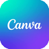
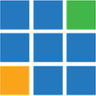

<h1 align="center">Hi , I'm Excel Amadi</h1>

  

  
  
  
  
  

Full-stack developer and graphic designer from Port Harcourt, Nigeria. I build web apps with **Next.js, Supabase and Tailwind**: file tools, galleries, interactive anatomy resources and websites for real businesses. I also run a tech community and lead its volunteer team.

**B.Sc. Anatomy student, University of Port Harcourt (UNIPORT)**

---

## Currently

- Building the **Stitchly** frontend (Next.js, React, TypeScript, Tailwind) with a team of three: a drag-and-drop clothing design editor that exports print-ready files. My part is the editor panels and the export flow.
- Doing the **Oasis Infobyte (OIBSIP)** Web Development Internship (November to December 2026).
- Doing the **CodeOrbit Tech** Full Stack Development Internship (November 2026).
- Building **[Absolute Anatomy](https://absolutee-anatomyy.vercel.app/)**, a free 3D anatomy atlas (work in progress).
- Sharpening my **JavaScript** and **React** skills.
- Open to **internships, mentorship, job opportunities**, collaborations and freelance web projects.

## About me

- **Excel Hephzibah Amadi**, online as **Xcelsama** ("Master of Excellence").
- Founder of **Tech-X**, a WhatsApp tech channel with 4,000+ followers, and leader of its volunteer team.
- Active member of **Salvation Ministries Home of Success**, serving on the Media Team (photo editing and live-stream production).

## Ask me about

- Responsive UIs with HTML, CSS, Tailwind and Bootstrap
- Next.js apps: pages, routing and deploying on Vercel
- Supabase: authentication, database and storage
- Connecting a frontend to a backend and moving data between them
- Client-side tools and PWAs that run without a server
- Websites and web systems for real businesses
- Turning anatomy into interactive web tools
- Graphic design: posters, flyers and visuals for events and brands
- Growing a tech community and leading a volunteer team

---

## Featured projects

| Project | What it is | Links |
|---|---|---|
| **Stitchly** | Drag-and-drop clothing design editor with print-ready export. I build the editor panels and export flow (Next.js, React, TypeScript, Tailwind). | Team project in progress |
| **Absolute Anatomy** | Free 3D anatomy atlas, work in progress. | [Live](https://absolutee-anatomyy.vercel.app/) |
| **SMHOS Church Registry** | Church registry and attendance system with role-based access (Next.js, Supabase). | |
| **AnyFile Viewer** | Opens 317+ file types in the browser, shipped as a PWA/APK. Runs client-side. | [Live](https://any-file-opener-ten.vercel.app/) · [GitHub](https://github.com/Xcelsama/Any-file-opener) |
| **AnyFile Compressor** | Squoosh-style compressor and converter for images, video, audio, PDF and docx (Next.js, no backend). | [GitHub](https://github.com/Xcelsama/anyfile-compressor) |
| **Excel's Gallery** | Personal gallery for my Lightroom before/after edits (Next.js, Supabase, Vercel). | [Live](https://excels-gallery.vercel.app/gallery) · [GitHub](https://github.com/Xcelsama/excels-gallery) |
| **SoundVault** | Sound-effects library for video editing (Next.js, Vercel). | [Live](https://soundvault-beta-six.vercel.app/login) |
| **Lens OCR** | OCR tool for extracting text from images. | [GitHub](https://github.com/Xcelsama/lens-ocr) |
| **Chitu-Ka Foods** | Website rebuild for a food business (Next.js). | [Live](https://ckf-farina-swallow.vercel.app/) |
| **Dock** | Personal file storage site (Next.js, Vercel). | [GitHub](https://github.com/Xcelsama/dock) |

More projects are on my [portfolio](https://xcelsama.is-a.dev) and in my [repositories](https://github.com/Xcelsama?tab=repositories).

---

<h3 align="center">Languages & Tools</h3>

  <table>
    <tr>
      <td align="center" valign="top">
        <h4>Frontend</h4>
        
      </td>
      <td align="center" valign="top">
        <h4>Backend & Data</h4>
        
      </td>
      <td align="center" valign="top">
        <h4>DevOps & Cloud</h4>
        
      </td>
      <td align="center" valign="top">
        <h4>Dev Tools</h4>
        
      </td>
    </tr>
  </table>

  <table>
    <tr>
      <td align="center" valign="top">
        <h4>Graphic Design & Photo</h4>
        
        
        
        
      </td>
      <td align="center" valign="top">
        <h4>Video & Live Production</h4>
        
        &nbsp;
        
        &nbsp;
        
      </td>
    </tr>
  </table>

<h3 align="center">Connect with me</h3>

  
  
  
  
  
  
  

<h3 align="center">GitHub Stats</h3>

  

  

